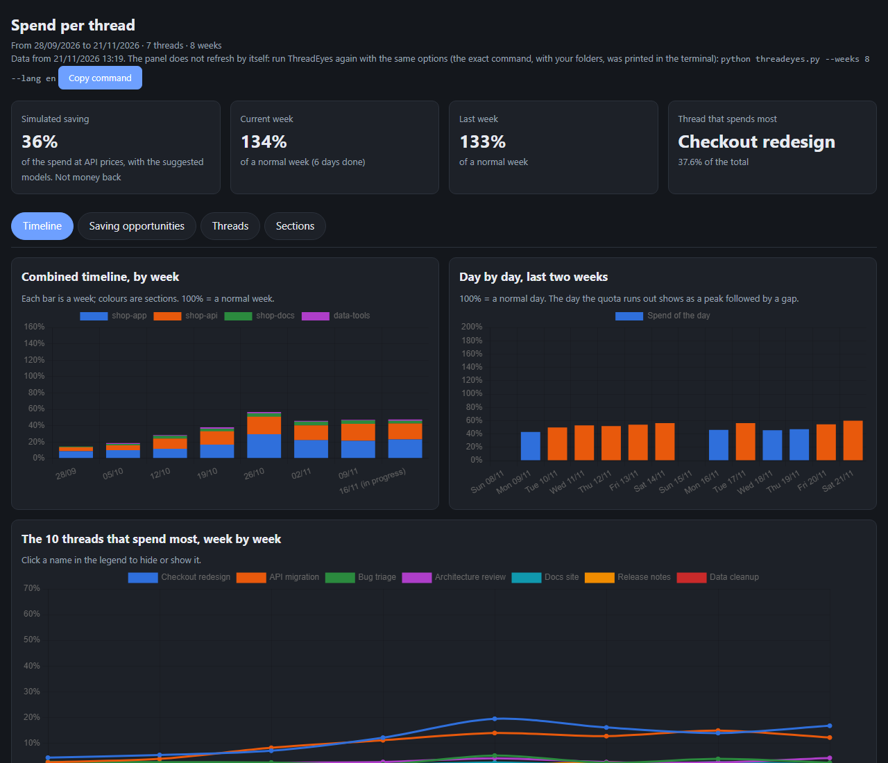

# ThreadEyes

**Que no se te acabe la cuota a mitad de semana.**

ThreadEyes te dice cuánto gasta cada uno de tus hilos de Claude Code, en qué trabaja y qué modelo le conviene. Lee los registros que Claude Code ya guarda en tu ordenador. Nada sale de tu máquina.

English: [README.md](README.md)



*La captura usa datos inventados (`examples/make_demo_data.py`), no el trabajo real de nadie.*

## Qué lo distingue

La mayoría de herramientas de uso listan las sesiones por su primer mensaje o por proyecto. ThreadEyes agrupa por el **nombre que tú le pones al hilo** y junta sus **relevos como un mismo hilo** («Rediseño del pago» y «Rediseño del pago · relevo 3» son uno). Después te dice, hilo a hilo, si basta con **cambiarle de modelo** o si conviene **dividirlo** porque hace dos trabajos distintos.

- Gasto por hilo, por semana y por día, frente a una semana normal: ves qué hilo se come la cuota y qué día se dispara.
- Qué hace cada hilo: construir, probar, leer o coordinar.
- Un modelo sugerido por hilo y el ahorro si lo sigues. Sugiere; decides tú.
- Un panel en tu navegador (HTML, funciona sin internet) y un informe en Markdown.
- Inglés y español.

## Empezar

Necesitas Python 3 (desarrollado y probado con la 3.14). No hay nada que instalar.

```bash
python threadeyes.py
```

Lee `~/.claude/projects` (o la carpeta `projects` dentro de la que indique `CLAUDE_CONFIG_DIR`), mira las últimas 8 semanas y escribe `threadeyes-output/threadeyes-report.md` y `threadeyes-output/threadeyes-panel.html`. Abre el panel en el navegador.

Pruébalo antes con datos inventados:

```bash
python examples/make_demo_data.py
python threadeyes.py --logs examples/demo-logs --out examples/demo-output
```

Opciones: `--weeks N` (2 o más), `--lang en|es`, `--out CARPETA`, `--logs CARPETA`, `--config ARCHIVO`. El idioma, si no lo indicas, sale de tu sistema; también puedes fijar la variable de entorno `THREADEYES_LANG`.

## Adáptalo a tus hilos (opcional)

Sin configurar nada:

- La **sección** de un hilo es la última carpeta de su directorio de trabajo.
- Un **relevo** se reconoce por una palabra como «relevo», «relevado», «handoff», «handover», «continued» o «cont.» al final del título, tras un separador (`Docs · relevo 2`, `Docs (cont. 2)`, `Docs - handoff`) o seguida solo de un número (`Docs relevo 4`).
- Dos hilos con el mismo nombre en **secciones distintas** se quedan separados.

Si tus nombres son otros, copia `threadeyes.example.json` a `threadeyes.json` (junto a donde lo ejecutes, o como `~/.threadeyes.json`; o pasa `--config`) y edítalo:

| Clave | Qué hace |
|:---|:---|
| `projects` | `{"mi-repo": "Facturación"}`: toda carpeta de trabajo que contenga `mi-repo` es la sección «Facturación» |
| `aliases` | Nombre antiguo del hilo → nombre actual, para hilos que renombraste |
| `merge_groups` | Varias grafías que son un mismo hilo: `{"name": "Docs", "contains_all": ["docs", "site"]}` |
| `judgment_keywords` | Comienzos de palabra (sin mayúsculas ni tildes) que marcan un hilo como trabajo de juicio, que se queda en el modelo más capaz |
| `scheduled_prefixes` | Los hilos cuyo nombre empieza así son tareas programadas, sugeridas para el modelo más barato |
| `relay_pattern` | Expresión regular del final de título que marca un relevo |
| `prices` | Precios propios por familia de modelo, p. ej. `{"opus": {"in": 4, "out": 20, "cr": 0.2}}` |
| `language`, `weeks` | Valores por defecto de `--lang` y `--weeks` |

## Cómo cuenta

- **Cada mensaje se cuenta una vez.** Claude Code escribe una línea de registro por cada bloque de contenido (texto, llamada a herramienta...) del mismo mensaje, y cada una repite el consumo de tokens del mensaje. ThreadEyes cuenta el coste de un mensaje una sola vez, por su identificador. Las llamadas a herramientas se cuentan una a una.
- **Tipo de trabajo:** sale de las herramientas usadas. Editar archivos es «construir»; ejecutar código, tests, git, el navegador o el ordenador es «probar»; leer y buscar es «leer»; mensajes, planes, subagentes y skills es «coordinar». Las órdenes de terminal se distinguen por su primera palabra.
- **Modelo sugerido:** los hilos que sobre todo conversan y los que su nombre empieza por una palabra de juicio se quedan en el modelo más capaz; el resto va al más barato. Es una regla práctica, no una medición de calidad.

## Cómo se entera de tus hilos

ThreadEyes no guarda ninguna lista de hilos ni recuerda nada entre una ejecución y otra. Cada vez que se ejecuta lee los registros que hay en el disco en ese momento y lo rehace todo, siempre con las mismas reglas:

| Qué pasa | Qué hace ThreadEyes |
|:---|:---|
| Empiezas un hilo nuevo | Aparece la próxima vez que se ejecute, en cuanto el hilo tenga actividad. No hay que darlo de alta |
| El hilo no tiene nombre | Va a «Hilos sin nombre» de su carpeta |
| Le cambias el nombre | Manda el último nombre: todo su historial pasa al nombre nuevo (usa `aliases` para juntar un nombre antiguo) |
| Lo relevas («Docs · relevo 3») | Cuenta como el mismo hilo |
| Lo archivas en la aplicación | Sigue contando: sus registros siguen en el disco |
| Se borran sus registros (tú o la limpieza de Claude Code) | Desaparece, y con él su gasto pasado |
| Lleva tiempo sin usarse | Sale de la ventana de semanas que se mira (8 por defecto) |

**No se ejecuta solo.** El panel dice de cuándo son sus datos y trae la orden exacta para actualizarlo; una página web no puede leer tus registros, así que el panel no puede actualizarse solo. Para tenerlo al día, ejecuta esa orden cuando quieras o prográmala con el programador de tareas de tu sistema (cron, launchd o el Programador de tareas de Windows).

## Lo que no hace (léelo)

- **El dinero solo sirve para comparar.** Es gasto ponderado con precios de la API. Con suscripción Pro o Max **no** es lo que pagas.
- **La tabla de precios es fija** (del 03/11/2026) y puede estar desactualizada. Compárala con la página de precios de Anthropic y cámbiala en la configuración si hace falta.
- **Depende del formato de los registros de Claude Code,** que no es una interfaz pública ni estable. Si Claude Code lo cambia, ThreadEyes puede dejar de leerlos hasta que se actualice.
- **Claude Code puede borrar registros antiguos.** Su documentación dice que guarda las conversaciones 30 días por defecto (ajuste `cleanupPeriodDays`), así que la historia que ve ThreadEyes es la que siga en el disco.
- **No cambia nada.** Solo lee y escribe sus dos archivos de salida. Sugiere un modelo; aplicarlo es cosa tuya.
- **Los hilos sin nombre** (nunca usaste `/rename`) se agrupan por carpeta y son menos precisos.
- Desarrollado y probado en Windows. Debería funcionar en macOS y Linux, pero no se ha probado allí.

## Privacidad

Lee tus conversaciones, así que decimos exactamente qué hace: [PRIVACIDAD.md](PRIVACIDAD.md). En corto: sin red, sin telemetría, sin cuenta y sin guardar nada aparte de los dos archivos que ves.

## Otras herramientas

ThreadEyes no es la única. ccusage (informes en terminal), cc-lens y token-dashboard (paneles locales) también leen esos registros y hacen bien lo suyo. Elige la que responda a tu pregunta; ThreadEyes es la que agrupa por el nombre del hilo y junta sus relevos.

## Licencia

MIT, ver [LICENSE](LICENSE). La librería de gráficos incluida (Chart.js, en `vendor/`) también es MIT y conserva su propia licencia.
