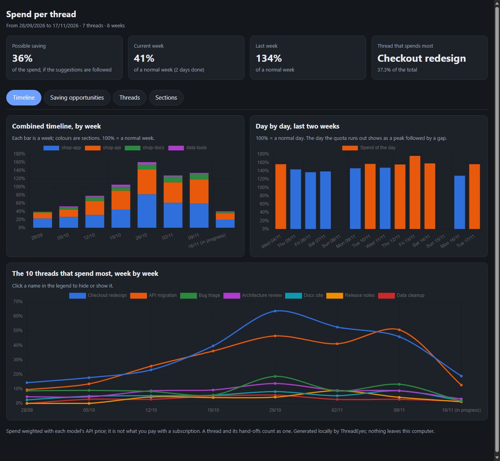

# ThreadEyes

**Don't run out of quota halfway through the week.**

ThreadEyes shows how much each of your Claude Code threads spends, what kind of work it does, and which model fits it. It reads the logs Claude Code already keeps on your computer. Nothing leaves your machine.

Español: [LEEME.md](LEEME.md)



*The screenshot uses invented data (`examples/make_demo_data.py`), not anyone's real work.*

## What makes it different

Most usage tools list sessions by their first message or by project. ThreadEyes groups by the **name you gave the thread** and treats its **hand-offs as the same thread** ("Checkout redesign" and "Checkout redesign · relevo 3" are one). Then it tells you, per thread, whether to **switch model** or to **split the thread** because it does two different jobs.

- Spend per thread, per week and per day, against a normal week, so you can see which thread eats your quota and the day it spikes.
- What each thread does: build, test, read or coordinate.
- A suggested model per thread, and the saving if you follow it. It suggests; you decide.
- A panel in your browser (HTML, works offline) and a Markdown report.
- English and Spanish.

## Quick start

You need Python 3 (developed and tested on 3.14). No packages to install.

```bash
python threadeyes.py
```

It reads `~/.claude/projects` (or the `projects` folder inside the one named by `CLAUDE_CONFIG_DIR`), looks at the last 8 weeks and writes `threadeyes-output/threadeyes-report.md` and `threadeyes-output/threadeyes-panel.html`. Open the panel in your browser.

Try it first with invented data:

```bash
python examples/make_demo_data.py
python threadeyes.py --logs examples/demo-logs --out examples/demo-output
```

Options: `--weeks N` (2 or more), `--lang en|es`, `--out FOLDER`, `--logs FOLDER`, `--config FILE`. The language otherwise comes from your system; you can also set the `THREADEYES_LANG` environment variable.

## Make it fit your threads (optional)

Without any setup:

- A thread's **section** is the last folder of its working directory.
- A **hand-off** is recognised by a word such as "relevo", "relevado", "handoff", "handover", "continued" or "cont." at the end of the title, after a separator (`Docs · relevo 2`, `Docs (cont. 2)`, `Docs - handoff`) or followed only by a number (`Docs relevo 4`).
- Two threads with the same name in **different sections** stay separate.

If your names differ, copy `threadeyes.example.json` to `threadeyes.json` (next to where you run it, or as `~/.threadeyes.json`; or pass `--config`) and edit it:

| Key | What it does |
|:---|:---|
| `projects` | `{"my-repo": "Billing"}`: any working folder containing `my-repo` is the section "Billing" |
| `aliases` | Old thread name → current name, for threads you renamed |
| `merge_groups` | Several spellings that are one thread: `{"name": "Docs", "contains_all": ["docs", "site"]}` |
| `judgment_keywords` | Word beginnings (no case, no accents) that mark a thread as judgment work, kept on the most capable model |
| `scheduled_prefixes` | Thread names starting with these are scheduled tasks, suggested for the cheaper model |
| `relay_pattern` | Regular expression for the hand-off suffix of a title |
| `prices` | Price overrides per model family, e.g. `{"opus": {"in": 4, "out": 20, "cr": 0.2}}` |
| `language`, `weeks` | Defaults for `--lang` and `--weeks` |

## How it counts

- **Each message is counted once.** Claude Code writes one log line per content block (text, tool call...) of the same message, each repeating the message's token usage. ThreadEyes counts a message's cost once, by its id. Tool calls are counted per call.
- **Type of work** comes from the tools used: editing files is "build"; running code, tests, git, the browser or the computer is "test"; reading and searching is "read"; messages, plans, sub-agents and skills are "coordinate". Shell commands are told apart by their first word.
- **Suggested model:** threads that mostly talk, and threads whose name starts with a judgment keyword, stay on the most capable model; the rest go to the cheaper one. It is a rule of thumb, not a measurement of quality.

## What it will not do (read this)

- **The money is only a way to compare.** It is spend weighted with API prices. With a Pro or Max subscription it is **not** what you pay.
- **The price table is static** (dated 2026-11-03) and may be out of date. Check it against Anthropic's pricing page and override it in the config if needed.
- **It depends on Claude Code's log format,** which is not a public, stable interface. If Claude Code changes it, ThreadEyes may stop reading until it is updated.
- **Claude Code may delete old logs.** Its documentation says conversations are kept 30 days by default (setting `cleanupPeriodDays`), so the history ThreadEyes can see is limited to what is still on disk.
- **It does not change anything.** It only reads and writes its two output files. It suggests a model; applying it is up to you.
- **Threads without a name** (you never used `/rename`) are grouped by folder, so they are less precise.
- Developed and tested on Windows. It should work on macOS and Linux but has not been tested there.

## Privacy

It reads your conversation logs, so we say exactly what it does: [PRIVACY.md](PRIVACY.md). Short version: no network, no telemetry, no account, nothing stored apart from the two files you can see.

## Other tools

ThreadEyes is not the only one. ccusage (terminal reports), cc-lens and token-dashboard (local panels) also read the same logs and are good at what they do. Pick the one that answers your question; ThreadEyes is the one that groups by thread name and joins hand-offs.

## License

MIT, see [LICENSE](LICENSE). The bundled chart library (Chart.js, in `vendor/`) is MIT as well and keeps its own licence.
